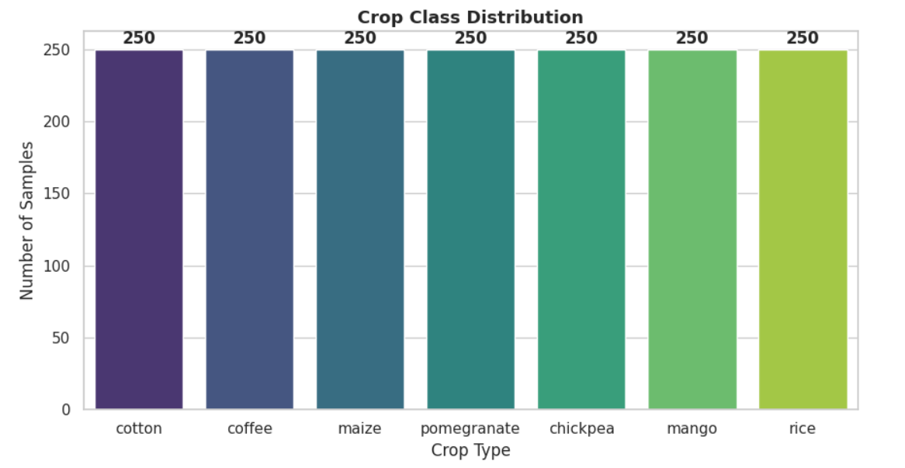
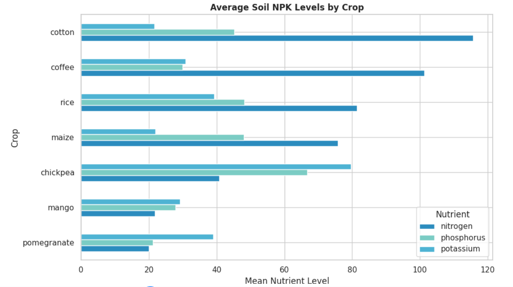
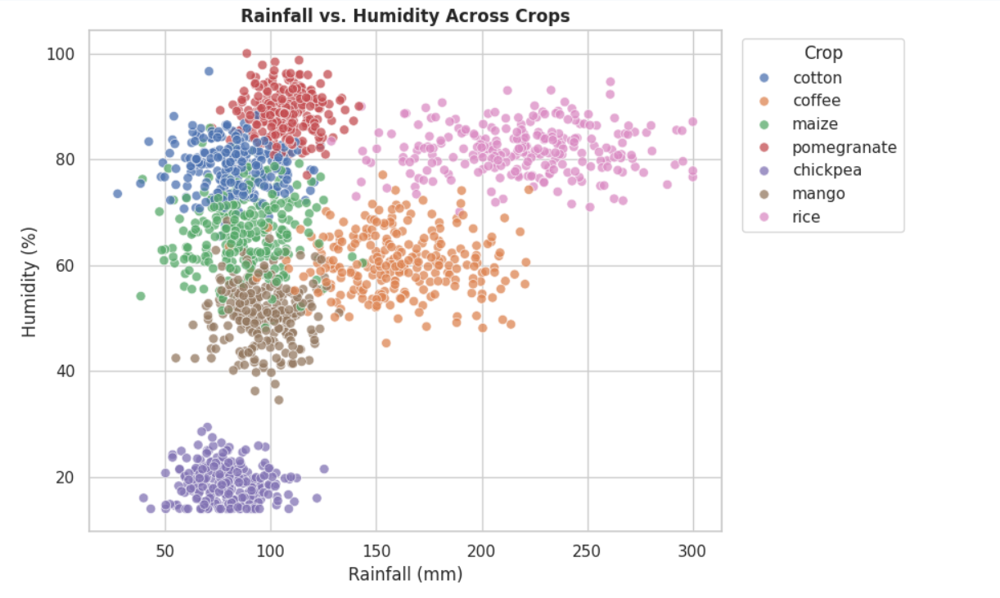
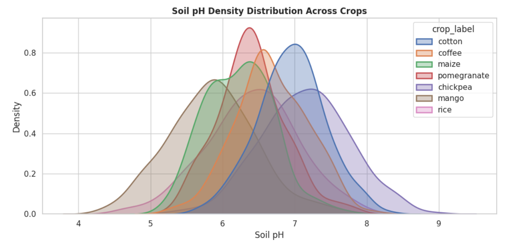
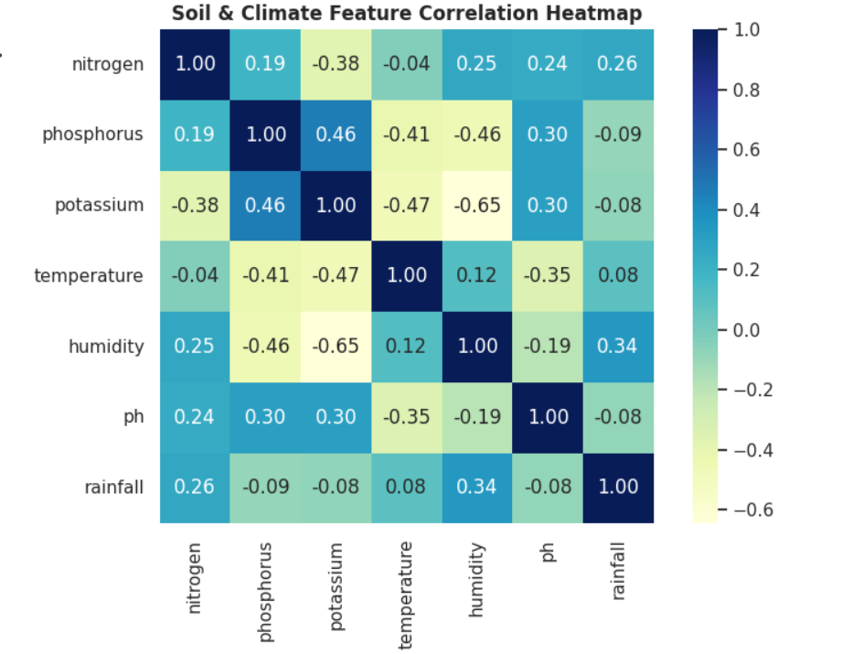

# Smart Crop Recommendation Multi-Class Classification using ANN

An **Artificial Neural Network (ANN)** built with TensorFlow/Keras to recommend suitable agricultural crops based on soil nutrient levels (`N`, `P`, `K`) and climate conditions (`temperature`, `humidity`, `ph`, `rainfall`).

## Dataset Overview
- **File:** `crop_recommendation.csv` (1,750 rows, 8 columns; 0 missing values, 0 duplicates)
- **Source:** Fully synthetic agricultural dataset generated using Google Gemini for educational and machine learning experimentation purposes (balanced across 7 crop classes, 250 samples each)
- **Input Features (7):** `nitrogen`, `phosphorus`, `potassium`, `temperature` (°C), `humidity` (%), `ph`, and `rainfall` (mm)
- **Target (`crop_label` — 7 classes):** `chickpea`, `coffee`, `cotton`, `maize`, `mango`, `pomegranate`, `rice`

## Exploratory Data Analysis (EDA)

### 1. Crop Class Distribution
All seven crop classes are evenly balanced with 250 samples each[cite: 11, 12].

[cite: 12]

### 2. Average Soil NPK Levels by Crop
Crops show distinct mean profiles across Nitrogen, Phosphorus, and Potassium[cite: 12].

[cite: 12]

### 3. Rainfall vs. Humidity Across Crops
Rainfall and humidity separate several crop groups into clear clusters[cite: 12].

[cite: 12]

### 4. Soil pH Density Distribution
Kernel density curves highlight typical pH ranges and overlap across the seven crops[cite: 12].

[cite: 12]

### 5. Feature Correlation Heatmap
Shows linear relationships across the seven continuous soil and weather features[cite: 12].

[cite: 12]

## Model Architecture & Training
- **Preprocessing:** `LabelEncoder` for target classes (`0`–`6`), 80/20 stratified train-test split, and `StandardScaler` fit on `X_train`[cite: 11].
- **Architecture:** Input (`7`) -> `Dense(64, activation="relu")` -> `Dropout(0.2)` -> `Dense(32, activation="relu")` -> `Dropout(0.2)` -> `Dense(7, activation="softmax")`[cite: 11].
- **Training:** `Adam` (`learning_rate=0.001`), `sparse_categorical_crossentropy`, `batch_size=32`, up to `80` epochs with `EarlyStopping(monitor="val_loss", patience=10, restore_best_weights=True)`[cite: 11].

## Results & Inference
- **Test Accuracy:** ~98.86% on the held-out test set.
- **Custom Prediction:** The notebook includes an inference cell (`new_sample`) that scales new soil and climate readings and prints the recommended crop along with percentage probabilities across all 7 classes.

## Key Takeaways
- **Strong Class Separability:** Distinct soil NPK and climate requirements give the ANN clear decision boundaries across all 7 crop classes[cite: 12].
- **Multi-Class ANN Pipeline:** Pairing `LabelEncoder`, `StandardScaler`, a 7-unit `softmax` output layer, and `sparse_categorical_crossentropy` handles 7-class probability outputs cleanly.
- **Overfitting Control:** Combining `Dropout(0.2)` with `EarlyStopping` helps keep training and validation performance well aligned.
